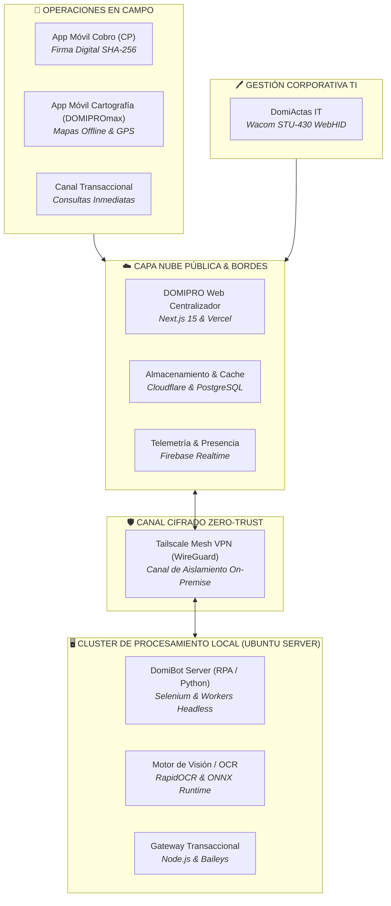

# ⚡ Ecosistema Domi
### Suite Corporativa de Digitalización, Automatización e Ingeniería de Terreno
**Dominion Guajira**

  <b>Plataforma integral de software, hardware biométrico y automatización robótica (RPA) diseñada para potenciar la eficiencia operativa, la trazabilidad digital y el soporte en campo en La Guajira.</b>

---

## 🌐 Visión General del Ecosistema

El **Ecosistema Domi** es una iniciativa de ingeniería de software y automatización desarrollada para unificar, digitalizar y acelerar los flujos de trabajo corporativos de **Dominion** en la operación de La Guajira. 

La plataforma articula aplicaciones móviles *offline-first*, paneles web administrativos en tiempo real, integración directa con hardware de captura biométrica (*WebHID*) y un cluster desacoplado de automatizaciones robóticas (RPA) e inteligencia artificial visual, estructurado bajo un modelo de **nube híbrida y procesamiento seguro on-premise**.

---

## 📦 Repositorios Centralizados del Ecosistema

Acceso directo a los proyectos que componen el repositorio de la organización:

### 1. 📑 [`domipro-cp`](https://github.com/Dominion-Guajira/domipro-cp)
> **Digitalización y Formalización de Acuerdos de Pago & Pagarés en Terreno**

* **Propósito:** Sustituir los talonarios físicos en maletín mediante formalización digital de acuerdos con firma táctil en pantalla y generación automática de pagarés inmutables con estampado criptográfico SHA-256.
* **Aspectos Técnicos:** Interfaz táctil reactiva, renderizado vectorial de documentos legales, compresión de firmas en curvas vectoriales y exportación PDF local certificada.
* **Enlace directo:** [Ver repositorio `domipro-cp`](https://github.com/Dominion-Guajira/domipro-cp)

---

### 2. 🗺️ [`domipromax-web`](https://github.com/Dominion-Guajira/domipromax-web)
> **Consola Web Administrativa & Visualizador Geoespacial Centralizado**

* **Propósito:** Panel de control unificado que consolida en tiempo real la información capturada por las aplicaciones móviles de campo, mapas satelitales interactivos y auditoría de presencia técnica.
* **Aspectos Técnicos:** Construido sobre Next.js 15 (App Router), soporte para capas GeoJSON y teselas cartográficas, visualización de cuadrillas vía WebSockets/Firebase y dashboards analíticos reactivos.
* **Enlace directo:** [Ver repositorio `domipromax-web`](https://github.com/Dominion-Guajira/domipromax-web)

---

### 3. ⚙️ [`DomiBot-server`](https://github.com/Dominion-Guajira/DomiBot-server)
> **Cluster de Automatización Robótica (RPA), Orquestación & Visión Artificial**

* **Propósito:** Servidor de procesamiento desatendido on-premise que ejecuta tareas pesadas de RPA, extracción documental contra sistemas corporativos y pipeline forense de OCR para cotejo masivo de campos.
* **Aspectos Técnicos:** Arquitectura de microservicios administrados bajo PM2, renderizado virtual Xvfb (:99 Full HD) para navegación desatendida, endpoints en FastAPI y aislamiento estricto en red privada local.
* **Enlace directo:** [Ver repositorio `DomiBot-server`](https://github.com/Dominion-Guajira/DomiBot-server)

---

### 4. 💬 [`DomiBot-web`](https://github.com/Dominion-Guajira/DomiBot-web)
> **Gateway Transaccional de Mensajería & Enlace Operativo con Terreno**

* **Propósito:** Gateway de mensajería bidireccional que permite a los colaboradores en terreno solicitar cupones, verificar órdenes y auditar soportes en segundos mediante comandos seguros estructurados.
* **Aspectos Técnicos:** Motor socket basado en Baileys, colas de procesamiento asíncrono con control anti-saturación, persistencia de sesiones en SQLite local y comunicación cifrada con el cluster RPA.
* **Enlace directo:** [Ver repositorio `DomiBot-web`](https://github.com/Dominion-Guajira/DomiBot-web)

---

### 5. 🖊️ [`DomiActas-IT`](https://github.com/Dominion-Guajira/DomiActas-IT)
> **Gestión Documental de Activos de TI & Firma Biométrica Directa con WebHID**

* **Propósito:** Digitalización de actas de entrega, devolución y deducción de activos tecnológicos con captura biométrica de trazo y presión (1024 niveles) en tabletas LCD Wacom STU-430 sin instalar controladores ni intermediarios locales.
* **Aspectos Técnicos:** Implementación directa de WebHID API y WebAssembly (`@wacom/signature-sdk`), guardado de actas para reedición, generador masivo en lote y compatibilidad con visores de Microsoft OneDrive / Outlook.
* **Enlace directo:** [Ver repositorio `DomiActas-IT`](https://github.com/Dominion-Guajira/DomiActas-IT)

---

## 🛠️ Stack Tecnológico Unificado

| Capa | Tecnologías Clave | Propósito en el Ecosistema |
| :--- | :--- | :--- |
| **Frontend & UI** | Next.js 15, React 19, TypeScript, Tailwind CSS | Interfaces web directivas y tableros administrativos de alta velocidad. |
| **Mobile & Terreno** | Flutter (Dart), React Native / PWA | Clientes móviles ligeros con soporte *offline-first* y cartografía local. |
| **Backend & Workers** | Python 3.11, FastAPI, Node.js, Selenium WebDriver | Automatización de tareas, conectores de sistemas empresariales y APIs internas. |
| **Hardware & Periféricos** | WebHID API, Wacom Signature SDK (WASM) | Comunicación USB pura con tabletas digitalizadoras Wacom STU-430. |
| **Visión & Documentos** | RapidOCR (ONNX Runtime), PDFKit, Docx Processor | Extracción automatizada de texto, cotejo forense y generación documental. |
| **Seguridad & Red** | Tailscale (WireGuard Mesh VPN), SHA-256 | Canales punto a punto cifrados de extremo a extremo sin exponer puertos públicos. |
| **Persistencia & Cloud** | PostgreSQL, SQLite local, Cloudflare D1/R2, Firebase | Gestión híbrida de estado: transacciones críticas en local y telemetría en la nube. |

---

## 🔒 Arquitectura de Seguridad y Privacidad

1. **Aislamiento de Entornos Sensibles:** Los procesos de automatización y almacenamiento de sesiones operan en un servidor on-premise dedicado dentro de la red corporativa, accesible remotamente únicamente a través de túneles cifrados **Tailscale Zero-Trust**.
2. **Desacoplamiento Nube-Local:** Las aplicaciones web públicas no alojan credenciales ni bases de datos sensibles de la operación interna, actuando como capas de presentación y consulta sincronizada.
3. **Integridad Criptográfica:** Los acuerdos y documentos formalizados en terreno incorporan sellado criptográfico mediante hashes **SHA-256**, garantizando inalterabilidad legal.
4. **Resiliencia Operativa:** Coexistencia de herramientas digitales con protocolos de contingencia física para continuidad de negocio en sectores de baja cobertura en La Guajira.

---

**Dominion Guajira • Transformación Digital e Innovación de Procesos**  
*Desarrollo e Iniciativa de Ingeniería por [RDFelix](https://github.com/RDFelix)*

